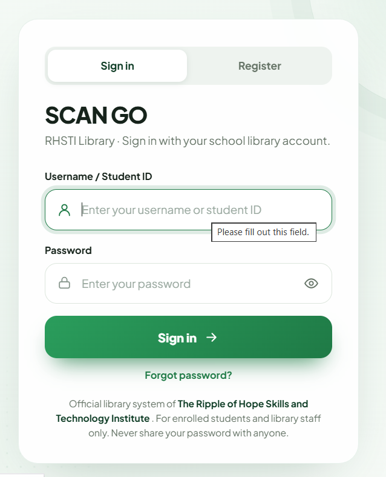
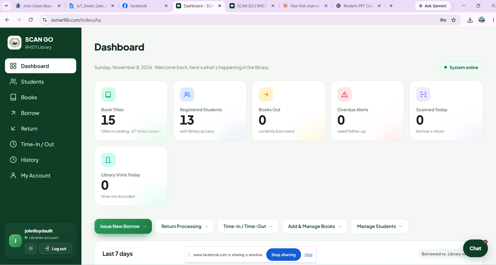
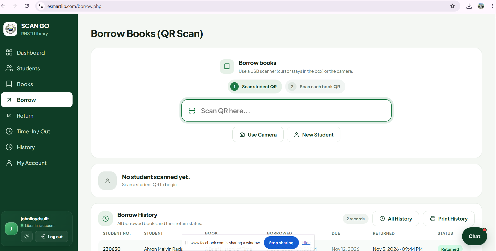
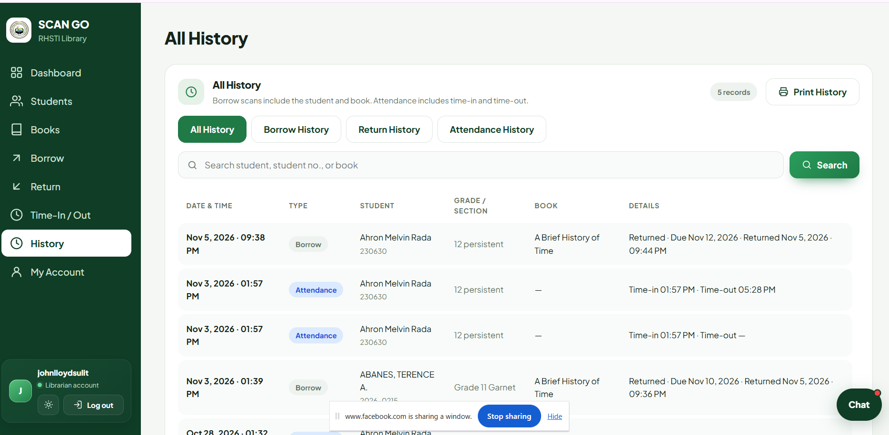
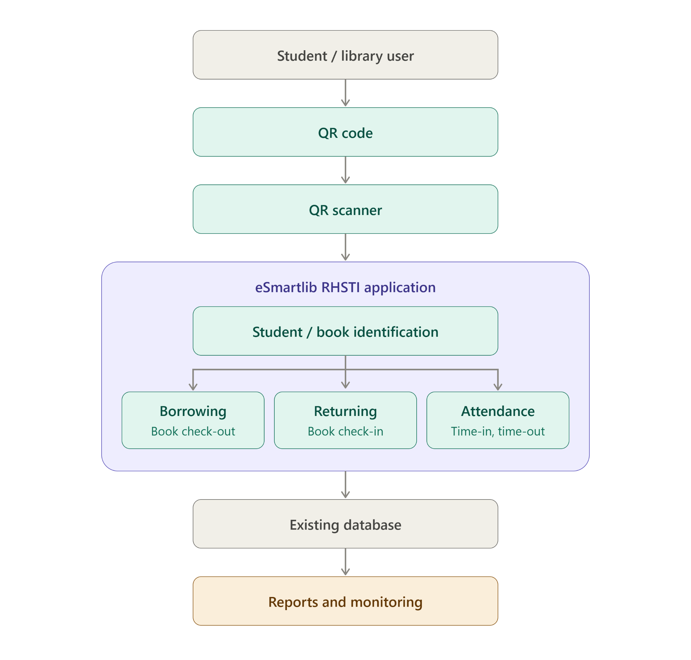
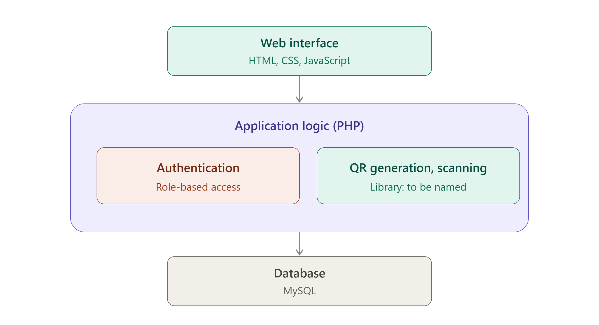
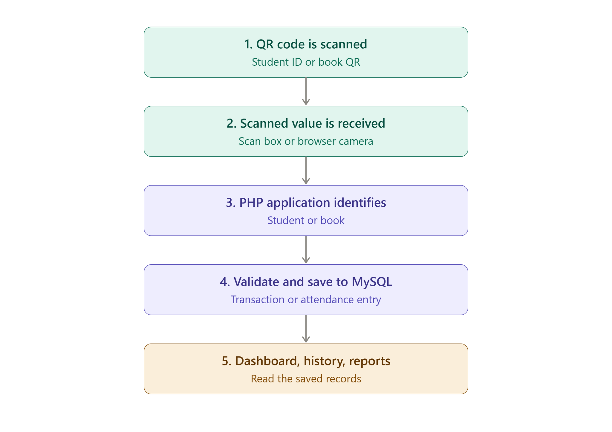
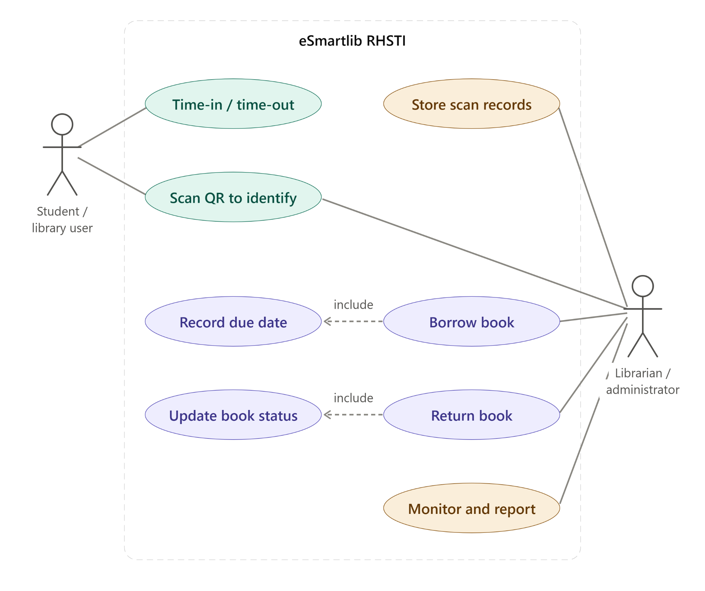

# eSmartlib-RHSTI-System

**An Enhanced Library Borrowing and Returning System Using QR Codes and Scanner, with Time-In/Time-Out Attendance**

Software Engineering 2 Project · Bachelor of Science in Computer Science
College of Computer Studies, Mabini Colleges, Inc., Daet, Camarines Norte
First Semester, A.Y. 2026–2027 · Instructor: Aeron Dave C. Enova

eSmartlib RHSTI extends the existing RHSTI Library Management System (The Ripple of Hope Skills and Technology Institute, Daet, Camarines Norte) with system-generated QR codes, scanner-based identification, and QR-based attendance. It builds on the existing PHP and MySQL system and database instead of replacing them.

## Screenshots

<!-- Replace with real screenshots (hide student personal data). Put the files in docs/images/ -->





## Problem

In the existing system, library staff manually search for and select student and book records when borrowing and returning, and there is no time-in/time-out attendance. This causes extra steps, slower and less consistent identification, and no organized scanner-based attendance record.

## Features

- Generates a QR code for every student and every book
- **Borrowing:** scan the student QR, then each book QR. The loan is saved with its due date and available copies are updated
- **Returning:** scan the book QR. The return date and time are saved, availability is restored, and the status is shown
- **Attendance:** the first scan is Time-In and the next scan is Time-Out
- Dashboard with counts, overdue alerts, and a 7-day activity chart
- Searchable history (all, borrow, return, attendance) with printing
- Import students and books from CSV; print QR codes and records
- Login with role-based access, password reset requests, and activate/deactivate student accounts
- Scanning through a USB scanner (types into the scan box) or the browser camera

## Tech Stack

| Layer | Technology |
|-------|------------|
| Frontend | HTML, CSS, JavaScript |
| Backend | PHP |
| Database | MySQL |
| Environment | XAMPP (Apache, MySQL) |
| QR and scanner | System-generated QR codes; USB scanner or webcam (library: *add name and version*) |
| Authentication | Login with role-based access control |
| Reporting | JavaScript-based charts |
| Hosting | Namecheap |

## System Design

**Architecture**



**Software components**



**Data flow**



**Use cases**



## Modules

Dashboard · Students · Books · Borrow · Return · Time-In/Out · History · Account & Requests

Main pages: `login.php`, `index.php` (dashboard), `students.php`, `books.php`, `borrow.php`, `return.php`, `attendance.php`, `history.php`

## Installation

Requirements: a web browser, XAMPP (Apache, PHP, MySQL), and a USB QR scanner or webcam.

1. Clone the repository:
   ```bash
   git clone https://github.com/<username>/<repo-name>.git
   ```
2. Copy the project folder into the XAMPP web directory (`htdocs/`), e.g. `htdocs/esmartlib_rhsti/`.
3. Start **Apache** and **MySQL** in the XAMPP Control Panel.
4. Open phpMyAdmin, create a database (e.g. `esmartlib_rhsti`), and import `<database file>.sql`.
5. Copy `<config.example file>` to `<config file>` and enter your own database settings. **Never commit real credentials.**
6. Create the first administrator account: *describe the procedure*.
7. Open `http://localhost/esmartlib_rhsti/` in your browser.
8. Connect the USB scanner (it types the QR value into the scan box) or allow the browser to use the webcam. Browsers usually allow camera access only on `localhost` or HTTPS.

## Usage

**Librarian / administrator**

1. Sign in with your username and password.
2. **Add a student or book:** open Students or Books, fill in the form, and select Add. A QR code is generated. For many records, use Import from CSV.
3. **Print QR codes:** in Students or Books, select Print QR Codes.
4. **Borrow:** open Borrow, click the scan box (or Use Camera), scan the student QR, then each book QR.
5. **Return:** open Return and scan the book QR.
6. **Attendance:** open Time-In/Out. The student scans their QR (first scan Time-In, next scan Time-Out).
7. **Review records:** open History, use search and filters, and use Print History for reports.

**Student:** present your QR code to the scanner for borrowing, returning, or attendance.

## Documentation

The full system documentation is in [`docs/eSmartlib_RHSTI_SE2_Documentation.docx`](docs/eSmartlib_RHSTI_SE2_Documentation.docx). It covers requirements, design, database, testing, security, user and administrator manuals, and deployment.

## Limitations

- Only students and books with a QR code and a record in the system can be scanned
- Needs a scanner or a device camera that the browser can access
- Needs a working connection to the server and database
- Covers the RHSTI library only
- Does not cover fines, payments, or a mobile app

## Security and Data Privacy

- Login with role-based access (the Admin account has full access to students, books, staff accounts, and settings)
- The system stores personal information of students. Follow the Data Privacy Act of 2012 (RA 10173) and the restrictions of the system owner
- Do not upload real student data, passwords, or database credentials to this repository. Hide personal data in any screenshot or report shown outside the library

## Team

| Member | Role |
|--------|------|
| Lacheca, Charles Kenneth | Security and access developer |
| Sulit, John Lloyd | System architect; security and access developer |
| Rada, Ahron Melvin | Lead programmer (PHP); front-end developer |
| Lozano, King Jasper | Tester / quality assurance |
| Asis, Karen Claire | Project manager / team leader; database administrator |
| Laguador, Jake | Systems analyst |
| Entong, Eduard John | Documentation and training officer |
| Era, Ken James | QR module developer |
| Sarte, Tim Jaztin | Attendance developer |
| Bascos, Francis | Database administrator |
| Turla, Alexander | Report and dashboard developer |
| Jalimao, John Vincent | Borrowing and returning developer |
| Agripa, John Carlo | Security and access developer |

## Acknowledgments

*List the libraries, tools, and sources used (QR generation, scanning, charts).*

## License

For academic purposes.