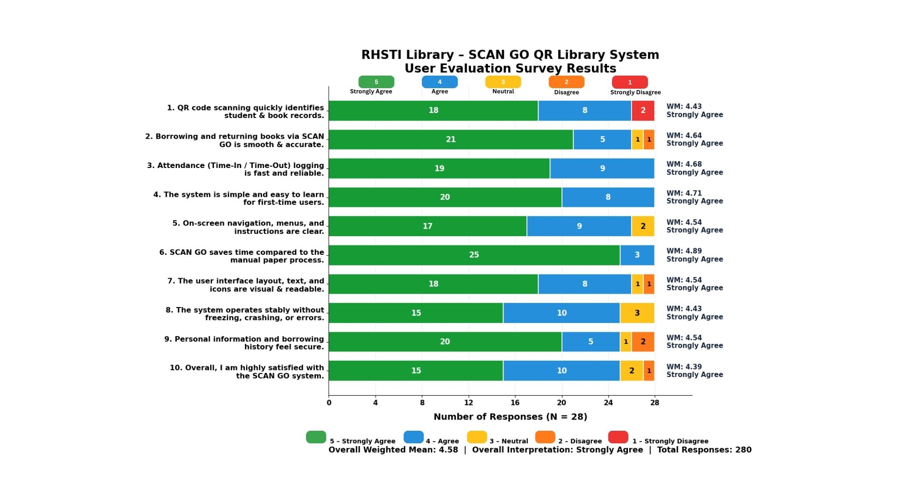

# System Testing Evaluation

# System Testing Evaluation 

### Item 1. QR Code Scanning Quickly Identifies Student and Book Records

The first evaluation item obtained a weighted mean of 4.43, interpreted as **"Strongly Agree."** 
This indicates that the respondents strongly agreed that the QR code scanning feature of the RHSTI Library – SCAN GO QR Library System can quickly identify student and book records.
The result suggests that the scanning functionality is effective in retrieving the necessary information.

### Item 2. Borrowing and Returning Books via SCAN GO is Smooth and Accurate

The second evaluation item obtained a weighted mean of 4.64, interpreted as **"Strongly Agree."** 
This indicates that the respondents strongly agreed that the system provides a smooth and accurate process for borrowing and returning books. 
The result demonstrates that the system effectively facilitates library transactions.

### Item 3. Attendance (Time-In / Time-Out) Logging is Fast and Reliable

The third evaluation item obtained a weighted mean of 4.68, interpreted as **"Strongly Agree."** 
This shows that the respondents strongly agreed that the attendance logging feature is fast and reliable. 
The result suggests that the system can efficiently record the time-in and time-out of users.

### Item 4. The System is Simple and Easy to Learn for First-Time Users

The fourth evaluation item obtained a weighted mean of 4.71, interpreted as **"Strongly Agree."** 
This indicates that the respondents found the system simple and easy to learn, even for first-time users. 
The result suggests that the system has a user-friendly design and can be easily understood.

### Item 5. On-Screen Navigation, Menus, and Instructions are Clear

The fifth evaluation item obtained a weighted mean of 4.54, interpreted as **"Strongly Agree."** 
This demonstrates that the respondents strongly agreed that the system's navigation, menus, and instructions are clear. 
The result indicates that the system provides an understandable interface for its users.

### Item 6. SCAN GO Saves Time Compared to the Manual Paper Process

The sixth evaluation item obtained a weighted mean of 4.89, interpreted as **"Strongly Agree."** 
This is the highest weighted mean among all evaluation items. It indicates that the respondents strongly agreed that the SCAN GO system saves time compared to the traditional manual paper-based process. 
The result highlights the system's efficiency in improving library operations.

### Item 7. The User Interface Layout, Text, and Icons are Visual and Readable

The seventh evaluation item obtained a weighted mean of 4.54, interpreted as **"Strongly Agree."** 
This indicates that the respondents strongly agreed that the system's interface layout, text, and icons are visually clear and readable. 
The result suggests that the system provides a visually understandable interface.

### Item 8. The System Operates Stably Without Freezing, Crashing, or Errors

The eighth evaluation item obtained a weighted mean of 4.43, interpreted as **"Strongly Agree."** 
This shows that the respondents strongly agreed that the system operates stably without frequent freezing, crashing, or errors. 
The result suggests that the system demonstrates satisfactory operational stability during testing.

### Item 9. Personal Information and Borrowing History Feel Secure

The ninth evaluation item obtained a weighted mean of 4.54, interpreted as **"Strongly Agree."** 
This indicates that the respondents strongly agreed that their personal information and borrowing history are secure when using the system. 
The result reflects a positive perception of the system's information security.

### Item 10. Overall, I am Highly Satisfied with the SCAN GO System

The tenth evaluation item obtained a weighted mean of 4.39, interpreted as **"Strongly Agree."** 
This indicates that the respondents expressed a high level of satisfaction with the RHSTI Library – SCAN GO QR Library System. 
Although this received the lowest weighted mean among the items, it still reflects a highly positive assessment of the system.

### Overall System Testing Evaluation

The overall System Testing Evaluation of the RHSTI Library – SCAN GO QR Library System obtained a weighted mean of 4.58, interpreted as **"Strongly Agree."** 
This indicates that the system was positively evaluated in terms of functionality, efficiency, usability, reliability, and security. 
The results suggest that the developed system effectively supports library operations and provides an efficient alternative to the traditional manual process.
